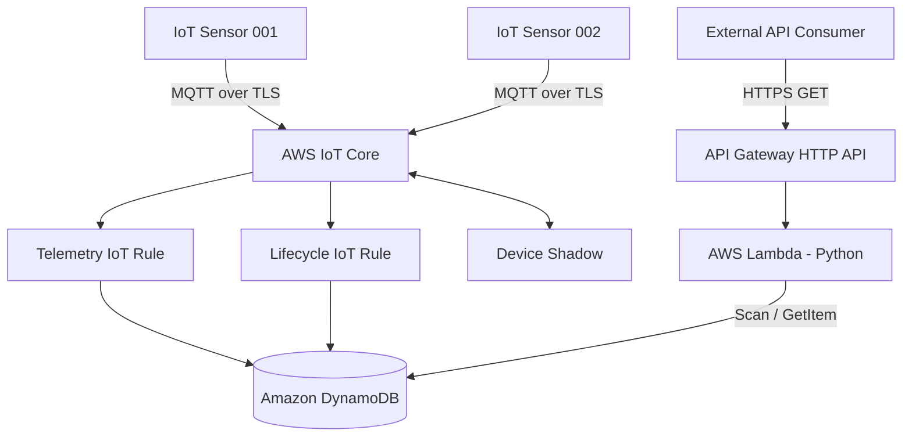

# AWS IoT Device Monitoring

A serverless IoT monitoring solution built with **AWS IoT Core, MQTT over TLS, X.509 certificates, AWS IoT Rules, DynamoDB, Device Shadow, AWS Lambda, API Gateway HTTP API, and Terraform**.

The project demonstrates secure device connectivity, telemetry ingestion, device lifecycle monitoring, remote device configuration, and a public read-only HTTPS API for retrieving device information.

## 1. Project Overview

The system simulates two IoT sensors:

- `sensor-001`
- `sensor-002`

Each device connects to AWS IoT Core using MQTT over TLS and an X.509 certificate. Devices publish telemetry measurements, while AWS IoT lifecycle events update their connection status.

AWS IoT Rules process incoming messages and persist device information in DynamoDB.

A separate serverless API exposes this information through HTTPS endpoints, allowing external applications to retrieve device records without directly accessing AWS services.

### Key capabilities

- MQTT connectivity over TLS using X.509 certificates.
- Telemetry ingestion through AWS IoT Core.
- Device lifecycle monitoring (connected/disconnected).
- DynamoDB persistence using AWS IoT Rules.
- Device Shadow for remote configuration.
- Public, read-only HTTPS API using API Gateway and Lambda.
- Infrastructure as Code with Terraform.
- Reproducible device and API validation.

## 2. Architecture



### Data flow

1. Simulated devices establish MQTT connections to AWS IoT Core using TLS and their X.509 certificates.
2. Each sensor publishes a telemetry message.
3. The telemetry IoT Rule processes messages from `devices/+/telemetry` and updates the corresponding DynamoDB record.
4. AWS IoT lifecycle events are processed by a separate rule and update device connection status.
5. Device Shadow stores desired device configuration.
6. External consumers query the public HTTPS API.
7. API Gateway invokes the Lambda function, which retrieves device information from DynamoDB.

## 3. AWS Services

| Service | Responsibility |
|---|---|
| AWS IoT Core | Device connectivity and MQTT messaging |
| AWS IoT Rules | Telemetry and lifecycle event processing |
| AWS IoT Device Shadow | Remote device configuration |
| Amazon DynamoDB | Device telemetry and status persistence |
| AWS Lambda | API business logic |
| Amazon API Gateway HTTP API | Public HTTPS endpoints |
| AWS IAM | Service roles and least-privilege permissions |
| Amazon CloudWatch | Lambda execution logs |
| Terraform | Infrastructure provisioning and management |

**Region:** `us-east-1`

## 4. Device Connectivity

The project uses MQTT over TLS with X.509 certificates.

Each simulated sensor has its own certificate and private key. The simulator publishes one telemetry measurement per execution and disconnects after receiving the MQTT publish acknowledgment.

Example telemetry payload:

```json
{
  "temperature": 24.5,
  "humidity": 65,
  "measured_at": "2026-11-06T16:28:54.776550+00:00"
}
```

Telemetry topic:

```text
devices/{device_id}/telemetry
```

Example:

```text
devices/sensor-001/telemetry
```

The IoT policy grants the device permissions for its own MQTT connection, telemetry topic, and supported Device Shadow topics.

## 5. Device Lifecycle Monitoring

AWS IoT Core lifecycle events are processed through a dedicated IoT Rule.

The rule listens to:

```text
$aws/events/presence/+/+
```

It updates the `device_status` attribute in DynamoDB.

Example:

```json
{
  "status": "disconnected",
  "event_timestamp": 1793983390126,
  "received_at": 1793983390154
}
```

This allows the system to maintain the latest known connection status for each device.

## 6. Device Shadow

AWS IoT Device Shadow enables remote configuration without requiring a direct application-level connection to the device.

The project validates the Shadow `update` and `get` operations using the simulated device credentials.

Example desired configuration:

```json
{
  "state": {
    "desired": {
      "reporting_enabled": true,
      "sampling_interval_seconds": 60
    }
  }
}
```

The update is acknowledged by AWS IoT Core, and a subsequent Shadow `get` retrieves the desired configuration.

The validation also demonstrates the `delta` state when desired properties have not yet been reported by the device.

Validation script:

```text
src/simulator/shadow_test.py
```

## 7. DynamoDB Data Model

Table:

```text
aws-iot-device-monitoring-devices
```

Configuration:

- Billing mode: `PAY_PER_REQUEST`
- Partition key: `device_id` (String)

Example logical record:

```json
{
  "device_id": "sensor-001",
  "telemetry": {
    "temperature": 24.5,
    "humidity": 65,
    "measured_at": "2026-11-06T16:28:54.776550+00:00",
    "received_at": 1793982534657
  },
  "device_status": {
    "status": "disconnected",
    "event_timestamp": 1793983390126,
    "received_at": 1793983390154
  }
}
```

The `telemetry` and `device_status` attributes are stored as JSON strings by the IoT Rules. The API Lambda parses these values and returns them as structured JSON objects.

## 8. Public Read-Only REST API

The project exposes a public HTTPS API using **Amazon API Gateway HTTP API** integrated with an AWS Lambda function running Python 3.12.

<important>Public endpoint — no authentication required.</important>

The API is intentionally designed for read-only access and does not expose operations to create, modify, or delete device records.

### Base URL

```text
https://ywws1rb5x3.execute-api.us-east-1.amazonaws.com
```

This is the endpoint from the validated deployment. It may change if the API Gateway resource is recreated.

### Available endpoints

| Method | Endpoint | Description |
|---|---|---|
| GET | `/devices` | Retrieve all registered devices |
| GET | `/devices/{device_id}` | Retrieve one device by ID |

### 8.1 List all devices

Request:

```http
GET /devices
```

Example:

```powershell
$API = "https://ywws1rb5x3.execute-api.us-east-1.amazonaws.com"

Invoke-RestMethod -Uri "$API/devices" -Method GET |
    ConvertTo-Json -Depth 10
```

Example response:

```json
{
  "count": 2,
  "devices": [
    {
      "device_id": "sensor-001",
      "device_status": {
        "status": "disconnected",
        "event_timestamp": 1793983390126,
        "received_at": 1793983390154
      },
      "telemetry": {
        "temperature": 24.5,
        "humidity": 65,
        "measured_at": "2026-11-06T16:28:54.776550+00:00",
        "received_at": 1793982534657
      }
    }
  ]
}
```

The response contains the total number of records and the device collection.

The Lambda function handles DynamoDB pagination to retrieve all available records.

### 8.2 Retrieve a specific device

Request:

```http
GET /devices/sensor-001
```

PowerShell example:

```powershell
Invoke-RestMethod -Uri "$API/devices/sensor-001" -Method GET |
    ConvertTo-Json -Depth 10
```

Returns the selected device record, including telemetry and lifecycle information.

### 8.3 Device not found

Request:

```http
GET /devices/sensor-999
```

Expected response:

```http
HTTP/1.1 404 Not Found
```

```json
{
  "message": "Device not found"
}
```

### API implementation

The Lambda function uses:

- `dynamodb:Scan` to list devices.
- `dynamodb:GetItem` to retrieve an individual device.
- JSON parsing to convert stored string attributes into structured objects.
- HTTP status codes to distinguish successful responses from missing records.

### API security and access model

The API is intentionally public and does not implement authentication or authorization at the API Gateway route level.

Current configuration:

- HTTPS endpoint managed by API Gateway.
- No API key requirement.
- No Cognito or custom authorizer.
- Read-only DynamoDB permissions for the Lambda execution role.
- No `PutItem`, `UpdateItem`, or `DeleteItem` permissions for the API Lambda.

**Important:** Public access means anyone who knows the endpoint can retrieve the available device information. The API is intended for demonstration and non-sensitive monitoring data. It should not expose confidential telemetry or production information without an appropriate authentication and authorization layer.

The read-only IAM policy limits what the Lambda function can do to DynamoDB; it does not make the public API private.

## 9. Repository Structure

```text
aws-iot-device-monitoring/
│
├── src/
│   └── simulator/
│       ├── sensor.py
│       ├── config.py
│       ├── shadow_test.py
│       ├── requirements.txt
│       ├── AmazonRootCA1.pem
│       └── sensors/
│           ├── sensor-001/
│           │   └── certs/
│           └── sensor-002/
│               └── certs/
│
├── terraform/
│   ├── backend.tf
│   ├── versions.tf
│   ├── providers.tf
│   ├── variables.tf
│   ├── locals.tf
│   ├── dynamodb.tf
│   ├── iot.tf
│   ├── iot_rules.tf
│   ├── iam.tf
│   ├── monitoring.tf
│   ├── outputs.tf
│   └── modules/
│       └── api/
│           ├── main.tf
│           ├── variables.tf
│           ├── outputs.tf
│           └── lambda/
│               └── handler.py
│
└── README.md
```

Private keys and device certificates must not be committed to the repository.

## 10. Deployment

### Prerequisites

- AWS account.
- AWS CLI configured with an appropriate profile.
- Terraform `>= 1.10`.
- Python 3.
- Device certificates and private keys provisioned in AWS IoT Core.

The project uses the AWS CLI profile:

```text
terraform-dev
```

Region:

```text
us-east-1
```

### Deploy infrastructure

From the repository root:

```powershell
cd terraform

$env:AWS_PROFILE = "terraform-dev"
$env:AWS_REGION = "us-east-1"

terraform init
terraform fmt -recursive
terraform validate
terraform plan
terraform apply
```

Terraform provisions the IoT infrastructure, DynamoDB table, IAM permissions, Lambda function, and API Gateway resources.

The API endpoint is exposed as a Terraform output:

```powershell
terraform output api_endpoint
```

### Run the device simulators

Open a terminal for each sensor:

```powershell
cd src/simulator

python .\sensor.py sensor-001
```

```powershell
cd src/simulator

python .\sensor.py sensor-002
```

Each execution publishes one telemetry measurement.

### Test the API

```powershell
$API = "https://ywws1rb5x3.execute-api.us-east-1.amazonaws.com"

Invoke-RestMethod -Uri "$API/devices" -Method GET

Invoke-RestMethod -Uri "$API/devices/sensor-001" -Method GET
```

## 11. Validation Results

The deployed solution was validated through end-to-end tests.

| Validation | Result |
|---|---|
| MQTT connection using X.509 certificates | Successful |
| Telemetry publication | Successful |
| Telemetry persistence in DynamoDB | Successful |
| Lifecycle event processing | Successful |
| Device status persistence | Successful |
| Device Shadow update | Successful |
| Device Shadow get | Successful |
| API: list devices | HTTP 200 |
| API: retrieve individual device | Successful |
| API: unknown device | HTTP 404 |
| Terraform deployment | 10 resources added, 0 changed, 0 destroyed |

The API list operation returned two device records, confirming that telemetry and lifecycle information were available through the public HTTPS endpoint.

## 12. Infrastructure and Security Considerations

- Infrastructure is managed through Terraform.
- Terraform state is stored remotely in Amazon S3 with state locking enabled.
- AWS IAM permissions follow a least-privilege approach for the API Lambda.
- Device connectivity uses TLS and X.509 certificates.
- Device credentials and private keys must remain outside version control.
- The public API is read-only but unauthenticated.
- The API is intended for demonstration data, not confidential production workloads.

The API's public access model is a deliberate design choice for demonstrating external data consumption through managed AWS services.

## 13. Cost Considerations

The project uses managed and serverless AWS services.

Potential costs depend on usage and resource configuration, including:

- AWS IoT Core messaging.
- DynamoDB requests and storage.
- Lambda invocations and execution duration.
- API Gateway requests.
- CloudWatch log ingestion and storage.
- Terraform state storage in S3.

Review deployed resources and AWS billing before leaving the environment running.

To remove the application infrastructure when it is no longer needed:

```powershell
cd terraform
terraform destroy
```

Review the destruction plan before confirming. The separately managed Terraform bootstrap/backend resources are not part of the application module's destruction.

---

## Project Summary

This project demonstrates an end-to-end AWS IoT monitoring architecture, from secure device connectivity and telemetry ingestion to persistent storage and external API consumption.

It combines event-driven serverless processing, device lifecycle tracking, remote configuration through Device Shadow, and infrastructure automation with Terraform.

The public read-only API provides a simple integration point for dashboards, monitoring applications, and other external consumers without exposing direct database access.